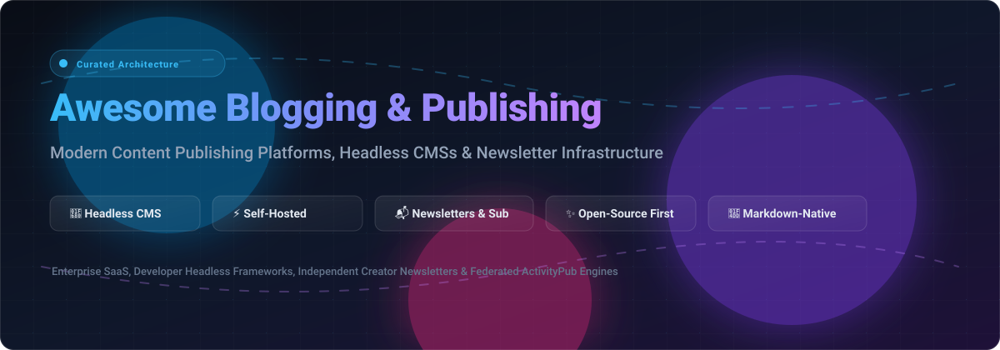

# 🚀 Awesome Blogging & Content Publishing Platform 🌟

**The ultimate curated directory of top blogging engines, headless CMSs, self-hosted web publishers, and creator newsletter platforms.**

  
  
  
  
  
  

  <i>A curated index for developers, tech writers, content creators, and media enterprises comparing self-hosted solutions, headless API architectures, and managed SaaS monetization platforms.</i>

---

## 📑 Table of Contents

- [🌐 Sector Overview & Market Dynamics](#-sector-overview--market-dynamics)
- [💼 SaaS & Managed Platforms](#-saas--managed-platforms)
- [⚡ Open-Source GitHub Projects](#-open-source-github-projects)
- [💡 Choosing the Right Publishing Stack](#-choosing-the-right-publishing-stack)
- [🤝 How to Contribute](#-how-to-contribute)
- [💖 Support & Sponsorship](#-support--sponsorship)
- [📊 Star History](#-star-history)
- [⚖️ Disclaimer](#️-disclaimer)

---

## 🌐 Sector Overview & Market Dynamics

The global **Content Management System (CMS) & Digital Content Publishing** market is estimated at **$33–$38 billion in 2025–2026**, with projections crossing **$75+ billion by 2033** (~10.6% CAGR). 

The sector exhibits **moderate fragmentation**:
- **Monolithic Dominance:** WordPress powers ~60% of all CMS-identified websites.
- **Visual Website Builders:** Wix, Squarespace, and Webflow lead drag-and-drop designer and SMB website publishing.
- **API-First & Headless CMS:** Strapi, Contentful, Sanity, Payload, and Directus provide omnichannel content backends decoupled from frontend rendering.
- **Audience & Newsletter Networks:** Substack and Ghost dominate writer-first monetization, email newsletters, and membership engines.

Because no single player dominates every niche simultaneously, the market rewards specialized architectures tailored to engineering flexibility, SEO velocity, or creator audience ownership.

---

## 💼 SaaS & Managed Platforms

| Platform | Company Size (Valuation / Revenue) | Starting Pricing (Paid) | Free Tier Limits | Best For / Key Notes |
| :--- | :--- | :--- | :--- | :--- |
| **[HubSpot Content Hub](https://www.hubspot.com/)** | ~$12.7B Market Cap (~$2.63B Rev) | $15/month per seat (billed annually) or $20/month | Free forever: 1 blog, basic web pages, 2 user seats, standard form submissions; displays permanent HubSpot branding | Businesses needing blogging natively connected to CRM, email marketing, and lead workflows. |
| **[Wix](https://www.wix.com/)** | ~$3.6B Market Cap (~$1.76B Rev) | $17/month (Light plan) | Free forever: 500 MB cloud storage, 1 GB bandwidth, `wixsite.com` subdomain, displays Wix ads; no custom domain or e-commerce | Beginners and small sites wanting drag-and-drop visual design with built-in blogging. |
| **[Squarespace](https://www.squarespace.com/)** | ~$7.2B Valuation (Acquired by Permira) | $16/month (Personal plan, billed annually) | 14-day free trial (extendable by 7 days to 21 days total); full template access and builder features, but site remains private on `squarespace.com` domain with checkout/indexing disabled | Creators and small businesses wanting polished, designer-grade website templates with integrated blogging. |
| **[WordPress.com](https://wordpress.com/)** | ~$7.5B Peak Valuation (~$500M ARR, Automattic) | $4/month (Personal plan, billed annually) | Free forever: 1 GB storage, `wordpress.com` subdomain, pre-installed themes; displays WordPress.com ads; third-party plugins/themes disabled | Users wanting managed WordPress hosting without server admin or database maintenance. |
| **[Webflow](https://webflow.com/)** | ~$4.0B Valuation (~$200M ARR) | $14/month (Basic plan, billed annually) / $23/month (CMS plan) | Free forever (Starter plan): 2 static pages, 50 CMS items, 1 GB bandwidth/month, 50 lifetime form submissions, `webflow.io` subdomain | Designers and frontend teams wanting visual CSS/HTML control over custom blog architectures. |
| **[Contentful](https://www.contentful.com/)** | ~$1.25B–$1.5B Valuation (Acquired by Salesforce, ~$100M ARR) | $300/month (Lite/Basic plan) | Free forever: Up to 10 users, 2 roles, 2 locales, 25 content types, 10,000 records, 100k API calls/month, 50 GB CDN bandwidth | Multi-channel teams and enterprises needing API-first headless content delivery to apps and sites. |
| **[Substack](https://substack.com/)** | ~$1.1B Valuation | Free to publish; 10% cut on paid subscriber revenue (+ Stripe fees) | Free forever: Unlimited newsletters, unlimited subscribers, unlimited posts, web archive, podcasts, and video publishing | Independent journalists and writers prioritizing email delivery, subscription revenue, and discovery network. |
| **[Medium](https://medium.com/)** | ~$600M Valuation (~$50M ARR) | $5/month or $50/year (Reader membership / Partner Program) | Free forever: Unlimited reading of free articles, unlimited draft/published posts on `medium.com/@user`; limited access to metered paywall stories | Writers seeking instant access to a built-in algorithmic readership and community without site management. |
| **[Sanity](https://www.sanity.io/)** | ~$35M–$40M ARR (~$85M Series C) | $15/month per seat (Growth plan) | Free forever: 20 user seats, 2 public datasets, 10,000 documents, 250k API requests/month, 100 GB CDN bandwidth/assets (hard caps, no overage fees) | Developers wanting a customizable real-time headless CMS with structured content modeling. |
| **[Ghost (Pro)](https://ghost.org/)** | ~$11.1M ARR (Not-for-profit foundation) | $9/month (Starter plan, billed annually) | 14-day free trial; full access to themes, newsletter sending, and member management; no credit card required; site goes offline if not upgraded | Professional creators wanting independent newsletters, paid memberships, and fast Markdown publishing. |

---

## ⚡ Open-Source GitHub Projects

Curated open-source blogging platforms, static publishing engines, and headless CMS frameworks, ranked strictly in descending order of GitHub community stars.

- **[Hugo](https://github.com/gohugoio/hugo)** 
  - **The world's fastest static website & blog generator engine** (Apache-2.0).
  - **Features**: Sub-millisecond build speeds written in Go; complete Markdown and shortcode support; built-in multilingual capability, asset pipelines, taxonomy classification, and extensive theme library.
  - **Tech Stack**: Go (single binary, cross-platform).
  - **Best For**: Developers who want lightning-fast build performance, zero database management overhead, and Git-backed Markdown hosting on GitHub Pages, Cloudflare Pages, or Vercel.

- **[Strapi](https://github.com/strapi/strapi)** 
  - **Leading open-source headless CMS built with JavaScript/TypeScript** (Community Edition).
  - **Features**: Highly customizable content-type builder, RESTful and GraphQL APIs out of the box, media library asset pipeline, granular role-based access control (RBAC), and broad plugin marketplace.
  - **Tech Stack**: Node.js, TypeScript, React, PostgreSQL/MySQL/SQLite.
  - **Best For**: Engineering teams powering modern web blogs and multi-platform applications using Next.js, Nuxt, Astro, or mobile clients.

- **[Ghost](https://github.com/TryGhost/Ghost)** 
  - **Premier professional publishing platform & newsletter engine** (MIT).
  - **Features**: Minimalist card-based rich-text and Markdown editor; native email newsletters; built-in paid subscriptions and member authentication (0% commission fees); SEO/social graph controls; Handlebars templating or headless Content API.
  - **Tech Stack**: Node.js, MySQL.
  - **Best For**: Independent writers, journalists, media publications, and businesses wanting an open-source, modern alternative to Substack and Medium.

- **[Payload CMS](https://github.com/payloadcms/payload)** 
  - **Code-first headless CMS & application framework natively built for Next.js and TypeScript** (MIT).
  - **Features**: Entire content schema declared directly in TypeScript; auto-generated GraphQL and REST endpoints; integrated React Admin UI; instant live previews; deep Next.js App Router integration.
  - **Tech Stack**: TypeScript, Node.js, Next.js, MongoDB/PostgreSQL/SQLite.
  - **Best For**: Full-stack developers wanting full code ownership, end-to-end type safety, and zero context switching between CMS and web frontend.

- **[Directus](https://github.com/directus/directus)** 
  - **Real-time data engine & headless CMS that layers over any SQL database** (BSL-1.1 / Open-Source).
  - **Features**: Wraps existing SQL databases with dynamic REST and GraphQL APIs; intuitive no-code admin studio; visual permissions and workflows; zero schema lock-in.
  - **Tech Stack**: Node.js, TypeScript, Vue.js, PostgreSQL/MySQL/SQLite/MS SQL.
  - **Best For**: Teams needing a headless content API backed directly by their existing production database schema.

- **[WordPress](https://github.com/WordPress/WordPress)** 
  - **The world's most ubiquitous content management system** (GPLv2).
  - **Features**: Block Editor (Gutenberg); unmatched ecosystem of tens of thousands of plugins and themes; built-in media management, taxonomies, comments, and REST API.
  - **Tech Stack**: PHP, MySQL/MariaDB.
  - **Best For**: Publishers demanding complete flexibility, extensive third-party integration options, and universal hosting compatibility.

- **[Zola](https://github.com/getzola/zola)** 
  - **Fast, single-binary static site generator powered by Rust** (MIT).
  - **Features**: Tera templating (inspired by Jinja2/Twig); built-in Sass compilation, syntax highlighting, search indexing, and automatic image processing with zero external dependencies.
  - **Tech Stack**: Rust (single standalone executable).
  - **Best For**: Technical bloggers seeking a fast, self-contained blogging engine with zero Node.js/Ruby dependency baggage.

- **[WriteFreely](https://github.com/writefreely/writefreely)** 
  - **Minimalist federated blogging platform with ActivityPub support** (AGPL-3.0).
  - **Features**: Distraction-free Markdown writing environment; multi-user community hosting; native ActivityPub federation to Mastodon and the Fediverse; strict privacy design with no ads or tracking.
  - **Tech Stack**: Go, SQLite/MySQL.
  - **Best For**: Privacy advocates, minimalists, and Fediverse participants who value simplicity and decentralized distribution.

- **[Squidex](https://github.com/squidex/squidex)** 
  - **Enterprise-grade open-source headless CMS and content hub** (MIT).
  - **Features**: Rich schema designer, GraphQL and REST support, real-time collaboration, asset management, and event-sourcing architecture.
  - **Tech Stack**: .NET Core, C#, TypeScript, MongoDB.
  - **Best For**: Enterprise teams seeking a robust headless CMS operating comfortably within the .NET and cloud container ecosystems.

- **[HTMLy](https://github.com/danpros/htmly)** 
  - **Databaseless flat-file blogging engine & CMS** (GPL-2.0).
  - **Features**: Flat-file Markdown text storage; zero database setup; built-in admin panel, categorization, tags, and theme customization.
  - **Tech Stack**: PHP (runs on any standard shared hosting environment).
  - **Best For**: Lightweight personal blogs requiring zero database maintenance and instant shared hosting setup.

- **[Markdown Ninja](https://github.com/skerkour/markdown-ninja)** 
  - **Markdown-first publishing engine for bloggers and startups** (AGPL-3.0).
  - **Features**: Publish websites, technical documentation, and email newsletters directly from raw Markdown files via a single Docker run command.
  - **Tech Stack**: Go, Docker.
  - **Best For**: Developers seeking zero-config pipelines from local Markdown files straight to published articles and email digests.

- **[Mataroa](https://github.com/mataroablog/mataroa)** 
  - **Minimalist, privacy-first blogging engine** (MIT).
  - **Features**: Clean typography, zero javascript trackers, native RSS feeds, simple Markdown formatting, and easy data export.
  - **Tech Stack**: Python (Django), SQLite.
  - **Best For**: Independent thinkers seeking a fast, distraction-free open-source Medium alternative.

- **[Bragi](https://github.com/sgaduuw/bragi)** 
  - **Self-hosted multi-site CMS for blogs, personal domains, and portfolios** (AGPL-3.0).
  - **Features**: Single-operator multi-site management; visual Markdown editor with draft previews; ActivityPub federation and Webmentions; import from Ghost, WordPress, and Hugo.
  - **Tech Stack**: Python (Flask), SQLite.
  - **Best For**: Operators managing multiple independent personal blogs and digital portfolios from a unified lightweight admin panel.

---

## 💡 Choosing the Right Publishing Stack

| Requirement | Top Recommendation | Why? |
| :--- | :--- | :--- |
| **Monetized Newsletters & Paid Memberships** | **[Ghost](https://github.com/TryGhost/Ghost)** or **[Substack](https://substack.com/)** | Native subscriber billing, automated email newsletters, and reader management. |
| **Zero-Maintenance Developer Blogs** | **[Hugo](https://github.com/gohugoio/hugo)** or **[Zola](https://github.com/getzola/zola)** | Blazing fast build times, static HTML output, Markdown content, and free Git-based hosting. |
| **Omnichannel Web & App Content** | **[Strapi](https://github.com/strapi/strapi)** or **[Payload CMS](https://github.com/payloadcms/payload)** | High-performance GraphQL/REST APIs, TypeScript typing, and decoupled frontend architecture. |
| **Max Customization & Giant Ecosystem** | **[WordPress](https://github.com/WordPress/WordPress)** | Thousands of themes, visual plugins, e-commerce integrations, and shared hosting support. |
| **Distraction-Free Decentralized Writing** | **[WriteFreely](https://github.com/writefreely/writefreely)** | ActivityPub integration enables federated interaction directly across Mastodon and the Fediverse. |

---

## 🤝 How to Contribute

Contributions are warmly welcome! Help us maintain this index as the most comprehensive, factual, and up-to-date guide on the web.

1. **Fork the repository** on GitHub.
2. **Add or update an entry** under the appropriate section.
3. **Follow the formatting guidelines**:
   - Provide clean name, link, Stars_Badge (for open-source), tech stack, and clear architectural trade-offs.
   - For SaaS products, verify pricing tiers, free tier limits, and valuation/revenue metrics.
4. **Submit a pull request** with a concise summary of additions.

---

## 💖 Support & Sponsorship

If you find this curated directory helpful for your projects, tech stack research, or publishing workflows, please consider supporting the project:

- ⭐ **Star this repository** to improve visibility across the GitHub community.
- 🍴 **Fork the repo** to share curated lists with your team and peers.
- ☕ **Support creator and maintenance work** on the [GitHub Sponsors Dashboard](https://github.com/sponsors/ishandutta2007).

---

## 📊 Star History

---

## ⚖️ Disclaimer

- This is a community-curated directory intended for research, architectural comparison, and benchmarking.
- Product pricing, features, and limits change over time; always confirm directly with vendor documentation.
- When managing subscriber lists or processing paid transactions on self-hosted instances, publishers are responsible for ensuring compliance with GDPR, CCPA, CAN-SPAM, and relevant privacy laws.

---

  <b>Built for developers, authors, journalists, and media publishers worldwide.</b> 
  Let's make digital blogging, content distribution, and newsletter publishing open, resilient, and creator-owned. 🚀

